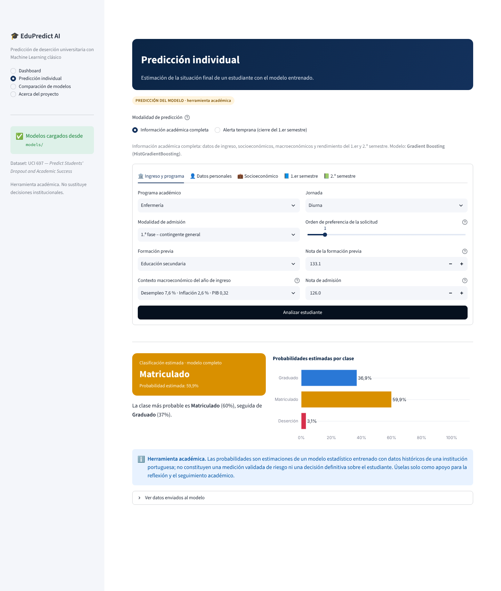
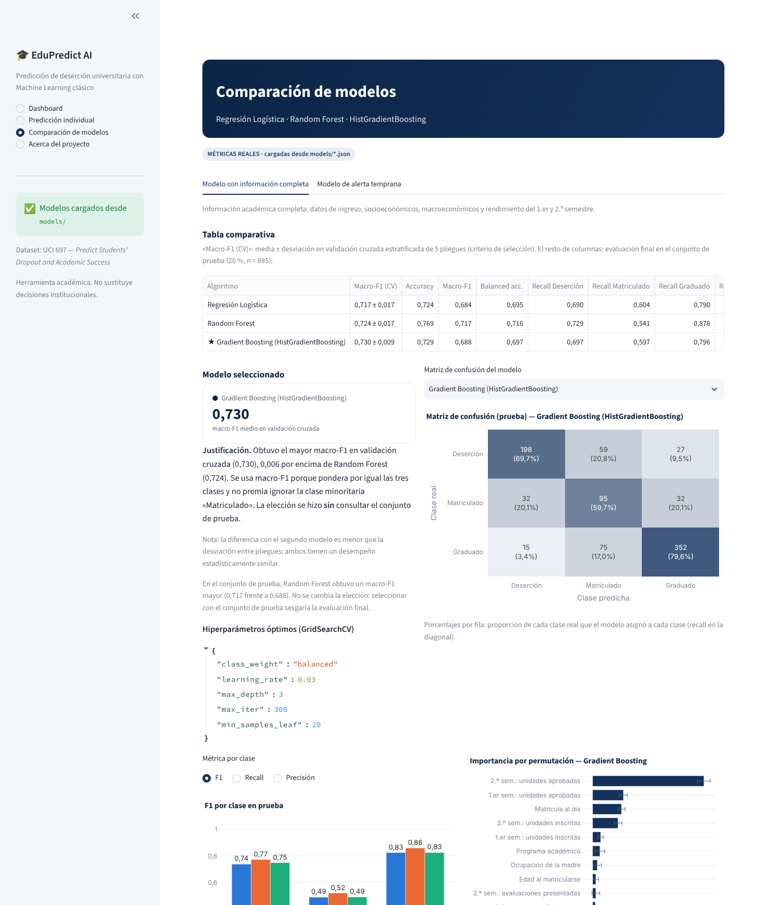
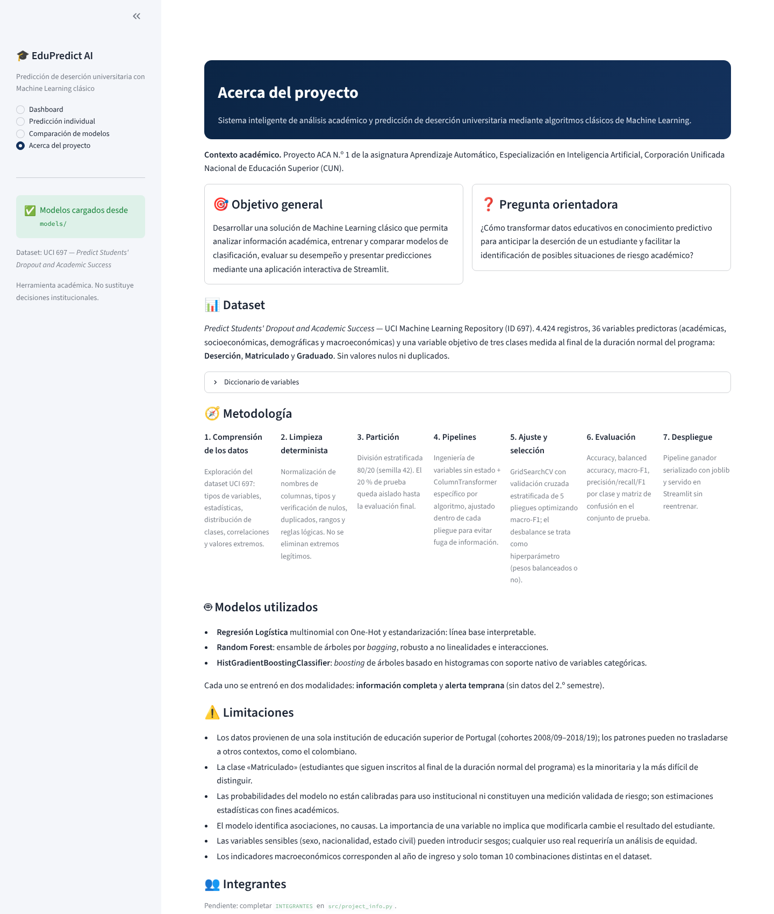

# 🎓 EduPredict AI

**Sistema inteligente de análisis académico y predicción de deserción universitaria mediante algoritmos clásicos de Machine Learning.**

Proyecto ACA N.º 1 — Aprendizaje Automático · Especialización en Inteligencia Artificial · Corporación Unificada Nacional de Educación Superior (CUN).


---

## 1. Descripción

EduPredict AI analiza el histórico de 4.424 estudiantes de educación superior, entrena y compara tres clasificadores clásicos de Scikit-learn y presenta los resultados en una aplicación Streamlit con cuatro secciones: **Dashboard**, **Predicción individual**, **Comparación de modelos** y **Acerca del proyecto**.

Las predicciones provienen exclusivamente de pipelines de Scikit-learn entrenados localmente; no se usan APIs de IA generativa.

## 2. Situación problema

La deserción universitaria tiene costos académicos, económicos y sociales. Las instituciones suelen identificar a los estudiantes en riesgo cuando ya es tarde para intervenir.

**Pregunta orientadora:** ¿Cómo transformar datos educativos en conocimiento predictivo para anticipar la deserción de un estudiante y facilitar la identificación de posibles situaciones de riesgo académico?

## 3. Objetivo general

Desarrollar una solución de Machine Learning clásico que permita analizar información académica, entrenar y comparar modelos de clasificación, evaluar su desempeño y presentar predicciones mediante una aplicación interactiva de Streamlit.

## 4. Dataset

| Atributo | Valor |
|---|---|
| Nombre | *Predict Students' Dropout and Academic Success* |
| Fuente | [UCI Machine Learning Repository, ID 697](https://archive.ics.uci.edu/dataset/697/predict+students+dropout+and+academic+success) — DOI [10.24432/C5MC89](https://doi.org/10.24432/C5MC89) |
| Registros | 4.424 estudiantes (sin nulos ni duplicados) |
| Variables predictoras | 36: 9 nominales, 8 binarias y 19 numéricas |
| Objetivo | 3 clases al final de la duración normal del programa: **Dropout** (Deserción, 32,1 %), **Enrolled** (Matriculado, 17,9 %), **Graduate** (Graduado, 49,9 %) |
| Archivo versionado | `data/data.csv` (CSV original de UCI, separador `;`, SHA-256 `3ef126de…c45ae`) |
| Archivo limpio | `data/estudiantes_limpio.csv` (nombres de columna normalizados, tipos validados) |

**Diccionario de datos.** Las columnas, unidades, rangos y la traducción al español de **todos** los códigos categóricos (programa, modalidad de admisión, formación previa, nacionalidad, nivel educativo y ocupación de los padres, etc.) están en [`src/data_dictionary.py`](src/data_dictionary.py) y se muestran en la aplicación (*Acerca del proyecto → Diccionario de variables*). Resumen de unidades:

| Grupo | Variables | Unidad |
|---|---|---|
| Notas de ingreso | Nota de admisión, nota de formación previa | escala 0–200 |
| Rendimiento semestral | Promedio de notas del 1.er / 2.º semestre | escala 0–20 (0 = ninguna unidad aprobada) |
| Unidades curriculares | Inscritas, aprobadas, convalidadas, evaluaciones, sin evaluación | número de asignaturas/evaluaciones |
| Personales | Edad al matricularse | años |
| Macroeconómicas | Desempleo, inflación (%), PIB (variación) | del año de ingreso, Portugal |
| Binarias | Becario, deudor, matrícula al día, desplazado, internacional, NEE, sexo, jornada | 1 = sí / 0 = no (sexo: 1 = masculino; jornada: 1 = diurna) |

El dataset se puede obtener de dos formas: (a) usar el CSV versionado en `data/data.csv` (la aplicación nunca necesita internet), o (b) descargarlo de UCI con `python -m src.train --download` (descarga solo si falta).

## 5. Arquitectura

```
edupredict-ml-streamlit/
├── app.py                         # Aplicación Streamlit (no entrena; solo carga artefactos)
├── requirements.txt               # Dependencias de ejecución (versiones fijadas)
├── requirements-dev.txt           # + pruebas y notebook
├── pytest.ini
├── .streamlit/config.toml         # Tema visual
├── data/
│   ├── data.csv                   # CSV original UCI 697
│   └── estudiantes_limpio.csv     # Resultado de src/data_loader.py
├── notebooks/
│   ├── ACA1_Student_Dropout.ipynb            # Notebook final del ACA, ejecutado (Pasos 1–4)
│   └── original/                             # Copia sin modificar del borrador entregado por el equipo
├── src/
│   ├── data_dictionary.py         # Columnas (nombres del borrador), tipos, unidades, códigos → español
│   ├── data_loader.py             # Descarga, lectura, limpieza y validación de consistencia
│   ├── preprocessing.py           # Conjuntos de variables, pipelines por modelo, validación de esquema
│   ├── train.py                   # GridSearchCV + selección por CV + exportación de artefactos
│   ├── evaluate.py                # Métricas multiclase, importancia por permutación
│   ├── predict.py                 # Carga de artefactos y predicción (usado por la app y las pruebas)
│   └── project_info.py            # Textos académicos, integrantes y enlaces
├── models/
│   ├── modelo.joblib / metadata.json / metricas.json                         # Información completa
│   └── modelo_temprano.joblib / metadata_temprano.json / metricas_temprano.json  # Alerta temprana
├── scripts/build_poster.py        # Genera docs/poster/poster.html desde las métricas reales
├── tests/                         # pytest: preprocesamiento, predicción y arranque de Streamlit
└── docs/
    ├── capturas/                  # Capturas reales de la aplicación
    ├── poster/                    # Contenido base y borrador del póster
    ├── referencias/               # Enunciado oficial del ACA (PDF) y correspondencia con los requisitos
    └── video/                     # Guion de la sustentación
```

Flujo: `data.csv → data_loader (limpieza determinista) → train (split 80/20 → GridSearchCV 5-fold → selección por CV → evaluación en prueba) → models/*.joblib + *.json → predict → app.py`.

> Se agregaron `data_dictionary.py` y `project_info.py` a la estructura sugerida para tener una única fuente de verdad de los códigos y de los textos académicos, y un segundo juego de artefactos (`*_temprano`) para el modelo de alerta temprana.

## 6. Metodología

El trabajo parte del notebook borrador del equipo (`notebooks/original/`), que se refactorizó sin perder su estructura, explicaciones ni algoritmos: el código reutilizable se trasladó a `src/` y el notebook (`notebooks/ACA1_Borrador_Student_Dropout.ipynb`) lo importa, de modo que notebook, entrenamiento y aplicación usan exactamente los mismos criterios. Los nombres de columna son los del borrador (`normalizar_nombre`: p. ej. `curricular_units_2nd_sem_approved`).

1. **Análisis exploratorio** (notebook, Parte 1): estructura, tipos, nulos (incluidos marcadores de texto), duplicados, estadística descriptiva con coeficiente de variación, asimetría, curtosis y prueba de normalidad, distribución del target, histogramas + KDE, boxplots, outliers por IQR, variables binarias y categóricas frente al target, correlaciones de Pearson, correlación con Dropout/Graduate y reglas de consistencia duras y blandas.
2. **Limpieza determinista** (notebook, Parte 2 · `src/data_loader.py`): se eliminan el BOM y el tabulador de los nombres de columna, se renombran a `snake_case`, se validan tipos, rangos documentados (notas 0–20 y 0–200, etc.) y reglas lógicas. Las reglas duras eliminarían registros imposibles (hay 0); las blandas marcan 912 casos atípicos pero posibles, que se conservan. **No se eliminan ni recortan valores extremos legítimos**: las edades altas corresponden a la vía de admisión «mayores de 23 años» y las notas 0 a semestres sin unidades aprobadas. El notebook verifica que su limpieza produce exactamente el mismo dataset que el pipeline.
3. **Partición** estratificada 80/20 con `random_state=42` (3.539 entrenamiento / 885 prueba).
4. **Pipelines sin fuga de información**: tasa de aprobación por semestre (transformación sin estado) → `WinsorizadorIQR` del borrador (opcional) → `ColumnTransformer` específico por algoritmo, ajustado dentro de cada pliegue:

   | Algoritmo | Nominales | Numéricas |
   |---|---|---|
   | Regresión Logística | One-Hot (categorías con < 10 casos → «infrecuente») | `StandardScaler` (+ winsorización IQR si la CV la elige) |
   | Random Forest | One-Hot | sin escalar |
   | HistGradientBoosting | Ordinal + categóricas nativas | sin escalar |

   Las categorías no vistas en entrenamiento se envían al grupo infrecuente (One-Hot) o a valor faltante (HGB): la predicción no falla.
5. **Desbalance de clases**: el borrador usaba `class_weight="balanced"` (sin datos sintéticos); aquí se incluye `class_weight` (sin ponderar vs. balanceado) en la rejilla y la validación cruzada decide.
6. **Ajuste y selección**: `GridSearchCV` con `StratifiedKFold(n_splits=5, shuffle=True, random_state=42)`, optimizando **macro-F1**. El ganador se elige por macro-F1 medio de validación cruzada; **el conjunto de prueba no interviene en la selección** y solo se usa para la evaluación final de los tres modelos.
7. **Alerta temprana** (experimento 4.9 del borrador): se repite el protocolo completo, con su propia búsqueda de hiperparámetros, sobre un conjunto de columnas que **excluye las 6 variables del 2.º semestre**, generando su propio artefacto, metadatos y métricas.

## 7. Modelos

| Algoritmo | Rejilla evaluada |
|---|---|
| Regresión Logística (multinomial, lbfgs) | `C` ∈ {0,01; 0,03; 0,1; 0,3; 1; 3} × `class_weight` ∈ {None, balanced} × `winsor` ∈ {passthrough, WinsorizadorIQR} |
| Random Forest (300 árboles) | `max_depth` ∈ {8, 12, None} × `min_samples_leaf` ∈ {1, 3, 5} × `max_features` ∈ {sqrt, 0,5} × `class_weight` ∈ {None, balanced_subsample} |
| HistGradientBoostingClassifier (categorías nativas) | `learning_rate` ∈ {0,03; 0,1} × `max_depth` ∈ {3, 6} × `min_samples_leaf` ∈ {20, 40} × `max_iter` ∈ {150, 300} × `class_weight` ∈ {None, balanced} |

Las rejillas son las del notebook borrador, ampliadas con `class_weight` y, en la Logística, con la winsorización.

## 8. Métricas reales

Valores generados por `python -m src.train` (archivos `models/metricas.json` y `models/metricas_temprano.json`), idénticos a los de la ejecución del notebook. CV = media ± desviación en 5 pliegues sobre entrenamiento; brecha = macro-F1 en entrenamiento − macro-F1 en validación (sobreajuste); prueba = 885 estudiantes nunca vistos. Filas ordenadas por macro-F1 en CV (criterio de selección).

### 8.1 Modelo con información completa (36 variables)

| Algoritmo | Macro-F1 (CV) | Brecha train–val | Accuracy (prueba) | Macro-F1 (prueba) | Balanced acc. (prueba) | Recall Deserción | Recall Matriculado | Recall Graduado | ROC-AUC OvR |
|---|---|---|---|---|---|---|---|---|---|
| **★ HistGradientBoosting** | **0,7303 ± 0,0085** | 0,13 | 0,7288 | 0,6879 | 0,6970 | 0,697 | 0,597 | 0,796 | 0,8811 |
| Random Forest | 0,7244 ± 0,0169 | 0,19 | 0,7695 | 0,7171 | 0,7159 | 0,729 | 0,541 | 0,878 | 0,8904 |
| Regresión Logística | 0,7174 ± 0,0174 | 0,04 | 0,7243 | 0,6839 | 0,6945 | 0,690 | 0,604 | 0,790 | 0,8827 |

**Modelo seleccionado: Gradient Boosting (HistGradientBoosting)** (`class_weight=balanced`, `learning_rate=0.03`, `max_depth=3`, `max_iter=300`, `min_samples_leaf=20`), por tener el mayor macro-F1 en validación cruzada y la menor desviación entre pliegues.

Decisiones validadas por la búsqueda de hiperparámetros: en los 6 modelos (3 algoritmos × 2 modalidades) se eligió la **ponderación balanceada de clases**; en la Regresión Logística se eligió `winsor=passthrough` (no recortar valores extremos).

Precisión / recall / F1 por clase en prueba del modelo seleccionado:

| Clase | Precisión | Recall | F1 | Soporte |
|---|---|---|---|---|
| Deserción | 0,808 | 0,697 | 0,749 | 284 |
| Matriculado | 0,415 | 0,597 | 0,490 | 159 |
| Graduado | 0,856 | 0,796 | 0,825 | 442 |

Matriz de confusión (filas = real, columnas = predicho; orden Deserción, Matriculado, Graduado): `[[198, 59, 27], [32, 95, 32], [15, 75, 352]]`.

> **Nota de interpretación.** En prueba, Random Forest obtuvo un macro-F1 superior (0,7171 vs. 0,6879). No se cambió la elección: hacerlo sería seleccionar con el conjunto de prueba. La diferencia en CV entre Gradient Boosting y Random Forest (0,006) es menor que la desviación entre pliegues, por lo que ambos deben considerarse de desempeño similar. Random Forest es una alternativa razonable si se prioriza el desempeño observado en prueba, pero esa preferencia no puede justificarse con el mismo conjunto que se usa para evaluar.

Variables de las que más depende el modelo (importancia por permutación en prueba, caída de macro-F1): 2.º sem.: unidades aprobadas (0,183), 1.er sem.: unidades aprobadas (0,051), matrícula al día (0,048), 2.º sem.: unidades inscritas (0,042), 1.er sem.: unidades inscritas (0,013).

**Comparación con el borrador.** Ejecutado tal como fue entregado, el notebook borrador obtiene para Gradient Boosting macro-F1 CV 0,728 ± 0,011 y macro-F1 en prueba 0,704 (Regresión Logística 0,697; Random Forest 0,695), cifras que coinciden con las de su Parte 5. Las diferencias con esta versión se deben a las correcciones de la sección 14 (selección por CV, categóricas nativas/one-hot, rejilla ampliada). En ambas versiones el modelo con mejor macro-F1 en CV es Gradient Boosting.

### 8.2 Modelo de alerta temprana (cierre del 1.er semestre, 30 variables)

| Algoritmo | Macro-F1 (CV) | Brecha train–val | Accuracy (prueba) | Macro-F1 (prueba) | Balanced acc. (prueba) | Recall Deserción | Recall Matriculado | Recall Graduado | ROC-AUC OvR |
|---|---|---|---|---|---|---|---|---|---|
| **★ HistGradientBoosting** | **0,6995 ± 0,0180** | 0,14 | 0,7107 | 0,6688 | 0,6767 | 0,662 | 0,579 | 0,790 | 0,8618 |
| Random Forest | 0,6943 ± 0,0238 | 0,14 | 0,7367 | 0,6846 | 0,6875 | 0,697 | 0,528 | 0,837 | 0,8695 |
| Regresión Logística | 0,6877 ± 0,0165 | 0,03 | 0,7040 | 0,6658 | 0,6757 | 0,669 | 0,591 | 0,767 | 0,8622 |

**Modelo seleccionado: Gradient Boosting (HistGradientBoosting)** (`class_weight=balanced`, `learning_rate=0.03`, `max_depth=3`, `max_iter=300`, `min_samples_leaf=20`). Este modelo responde a otra pregunta (anticipar con información limitada) y no debe compararse directamente con el modelo completo.

## 9. Instalación

Requiere Python 3.11–3.13.

```bash
git clone https://github.com/DanielSQN/edupredict-ml-streamlit.git
cd edupredict-ml-streamlit
python -m venv .venv
source .venv/bin/activate          # Windows: .venv\Scripts\activate
pip install -r requirements-dev.txt   # o requirements.txt si solo va a ejecutar la app
```

## 10. Entrenamiento

```bash
python -m src.train              # usa data/data.csv (≈3 min con 4 núcleos)
python -m src.train --download   # descarga el CSV de UCI si no existe
python -m src.train --n-jobs 2   # limitar procesos
```

Genera `data/estudiantes_limpio.csv` y los seis archivos de `models/`. El proceso es determinista: dos ejecuciones producen exactamente las mismas métricas.

Pruebas:

```bash
python -m pytest
```

## 11. Ejecución de Streamlit

```bash
streamlit run app.py
```

Abrir http://localhost:8501. La aplicación no entrena modelos: si faltan los artefactos, lo indica y sugiere ejecutar el entrenamiento.

## 12. Despliegue en Streamlit Community Cloud

1. Subir el repositorio a GitHub (incluye `models/` y `data/`).
2. En [share.streamlit.io](https://share.streamlit.io) → *Create app* → seleccionar el repositorio, la rama y el archivo principal `app.py`.
3. En *Advanced settings* elegir **Python 3.12 o 3.13**.
4. Desplegar. `requirements.txt` instala las dependencias; todas las rutas son relativas a la raíz del proyecto.

**Procedencia de los artefactos versionados.** Los archivos de `models/` se generaron con `python -m src.train` sobre `data/data.csv` (SHA-256 completo en `models/metadata.json`), con Python 3.13, scikit-learn 1.9.1, pandas 3.0.5 y numpy 2.5.3. `scikit-learn` está fijado a la misma versión en `requirements.txt` porque los archivos `joblib` no son portables entre versiones. Si cambia la versión, regenere los artefactos con `python -m src.train`.

### Póster

```bash
python scripts/build_poster.py   # regenera docs/poster/poster.html con las métricas de models/
```

Abrir `docs/poster/poster.html` en Chrome/Edge → *Imprimir → Guardar como PDF* (tamaño A1, sin márgenes, gráficos de fondo activados). El póster final es `docs/poster/poster_EduPredictAI.pdf`. Usa el logo `docs/poster/logo_cun.png` y los códigos QR `qr_app.png`, `qr_video.png` y `qr_repositorio.png` de la misma carpeta; los nombres, el docente y los enlaces se leen de `src/project_info.py`.

## 13. Capturas de pantalla

| Dashboard | Predicción individual |
|---|---|
|  |  |
| **Comparación de modelos** | **Acerca del proyecto** |
|  |  |

## 14. Correcciones y decisiones metodológicas

### 14.1 Respecto al notebook borrador

El borrador original se conserva sin cambios en `notebooks/original/`. Se ejecutó tal como fue entregado y sus cifras reproducen las que reporta su Parte 5; la revisión encontró estos puntos, corregidos en la versión refactorizada (marcados con 🔧 en el notebook):

| Borrador | Corrección | Motivo |
|---|---|---|
| El mejor modelo se elegía por macro-F1 en el **test** (sección 4.10) | Selección por **macro-F1 medio de validación cruzada**; el test solo evalúa | Elegir con el test lo convierte en validación y sesga la estimación final |
| Winsorización IQR fija de notas de ingreso/previa y edad | Opción de la rejilla de la Regresión Logística, decidida por CV (resultado: no winsorizar) | Recortaba a 34 años a 441 estudiantes (10 %), con 53,7 % de deserción frente a 29,7 % del resto: información legítima |
| Gradient Boosting y Random Forest con `OrdinalEncoder` sobre códigos nominales | HistGradientBoosting con categorías nativas; Random Forest con One-Hot | Códigos como `course = 9500` no son magnitudes |
| `application_order` categórica | Numérica ordinal | Es un ranking de preferencia (0 = primera opción) |
| `class_weight="balanced"` fijo | Hiperparámetro validado por CV | Justificación empírica del tratamiento del desbalance |
| Alerta temprana con los hiperparámetros del modelo completo | Modelo independiente con su propia búsqueda, artefacto y métricas | Los hiperparámetros óptimos dependen de las variables disponibles |
| Imputación antes de la partición | Documentado (0 nulos ⇒ sin efecto); en datos futuros debe ir dentro del pipeline | Evitar fuga de información |
| Exportaba `train.csv`, `test.csv`, metadatos sueltos y descargas de Colab | Un solo CSV limpio y artefactos en `models/` | Una sola fuente de verdad, reproducible con la semilla |
| Cifras de conclusiones escritas a mano | Calculadas en la ejecución | Trazabilidad |

Se conservaron: la estructura de 5 partes, las explicaciones, el EDA completo (estadística descriptiva con CV, asimetría, curtosis y normalidad; outliers IQR; reglas duras/blandas; correlaciones), los tres algoritmos y sus rejillas, la CV base vs. ajustada, el análisis de sobreajuste, los coeficientes de la Logística, la importancia por permutación y el experimento de alerta temprana.

### 14.2 Decisiones generales

- **Nombres de columna**: el CSV de UCI trae BOM y un tabulador en `Daytime/evening attendance\t`; se normalizan con la función `normalizar_nombre` del borrador antes de cualquier uso.
- **Sin fuga de información**: escalado, codificación y winsorización viven dentro del pipeline y se ajustan por pliegue.
- **Outliers**: se conservan los valores extremos legítimos.
- **Coherencia notebook–pipeline–interfaz**: el notebook y la app importan los mismos módulos de `src/`; el notebook verifica que su limpieza coincide con la del pipeline y las pruebas verifican que la predicción desde la interfaz coincide con el pipeline directo.
- **Alerta temprana**: la prueba `test_early_model_does_not_use_second_semester` verifica que el modelo no use variables del 2.º semestre.

## 15. Limitaciones

- Datos de una sola institución portuguesa (cohortes 2008/09–2018/19); los patrones pueden no trasladarse a otros contextos.
- La clase *Matriculado* es minoritaria y la más difícil (F1 ≈ 0,52).
- Las probabilidades no están calibradas para uso institucional; son estimaciones académicas, no una medición validada de riesgo.
- El modelo identifica asociaciones, no causas. Variables sensibles (sexo, nacionalidad) podrían introducir sesgos.

## 16. Referencias (APA 7)

- Breiman, L. (2001). Random forests. *Machine Learning, 45*(1), 5–32. https://doi.org/10.1023/A:1010933404324
- Friedman, J. H. (2001). Greedy function approximation: A gradient boosting machine. *The Annals of Statistics, 29*(5), 1189–1232. https://doi.org/10.1214/aos/1013203451
- Ke, G., Meng, Q., Finley, T., Wang, T., Chen, W., Ma, W., Ye, Q., & Liu, T.-Y. (2017). LightGBM: A highly efficient gradient boosting decision tree. *Advances in Neural Information Processing Systems, 30*, 3146–3154.
- Martins, M. V., Tolledo, D., Machado, J., Baptista, L. M. T., & Realinho, V. (2021). Early prediction of student's performance in higher education: A case study. En Á. Rocha, H. Adeli, G. Dzemyda, F. Moreira, & A. M. Ramalho Correia (Eds.), *Trends and applications in information systems and technologies* (pp. 166–175). Springer. https://doi.org/10.1007/978-3-030-72657-7_16
- Pedregosa, F., Varoquaux, G., Gramfort, A., Michel, V., Thirion, B., Grisel, O., Blondel, M., Prettenhofer, P., Weiss, R., Dubourg, V., Vanderplas, J., Passos, A., Cournapeau, D., Brucher, M., Perrot, M., & Duchesnay, É. (2011). Scikit-learn: Machine learning in Python. *Journal of Machine Learning Research, 12*, 2825–2830. https://jmlr.org/papers/v12/pedregosa11a.html
- Realinho, V., Machado, J., Baptista, L., & Martins, M. V. (2022). Predicting student dropout and academic success. *Data, 7*(11), Artículo 146. https://doi.org/10.3390/data7110146
- Realinho, V., Vieira Martins, M., Machado, J., & Baptista, L. (2021). *Predict students' dropout and academic success* [Conjunto de datos]. UCI Machine Learning Repository. https://doi.org/10.24432/C5MC89
- Streamlit Inc. (2026). *Streamlit* (Versión 1.66.1) [Software]. https://streamlit.io

## 17. Enlaces públicos

- Repositorio: https://github.com/DanielSQN/edupredict-ml-streamlit
- Aplicación en Streamlit Community Cloud: https://edupredict-ml-app-cv2fdreafkspczy39oa7nu.streamlit.app/
- Video de sustentación: https://www.youtube.com/watch?v=BEmN8dqMv-o

## 18. Integrantes

| # | Nombre |
|---|---|
| 1 | Paula Carolina Calvo Pérez |
| 2 | Juan Sebastián Caviedes Roa |
| 3 | Jonathan Camilo Flórez Bolívar |
| 4 | Daniel Santiago Quintero Niño |

Docente: Dr. Hamilton Rivera Flor.
